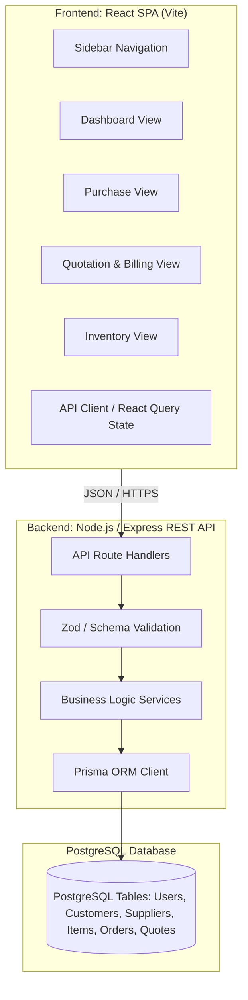

# Glass Production Facility ERP - Specification & Implementation Plan

## Goal Description
Design and implement a full-stack Enterprise Resource Planning (ERP) web application tailored specifically for a **Glass Production Facility**. The system centralizes core industrial operations into four primary functional hubs:
1. **Interactive Dashboard**: KPI overview, total sales trend graph, recent sales, top produced glass materials, recent material purchases, and operational quick links.
2. **Purchase Management**: Streamlined recording of raw materials (float glass packs, silica, cullet, PVB interlayers, sealants, spacers), quantity & units, supplier/seller profiles, and procurement costs.
3. **Quotation & Billing Engine**: Precision estimation for glass products supporting both Individual and Organizational clients, calculating pricing based on square footage/meters, thickness, glass treatments (tempering, lamination, Low-E coating), and fabrication edge-work.
4. **Inventory Management**: Real-time stock tracking for raw sheets, finished architectural glass, cut-offs, and hardware, equipped with low-stock alerts, rack/A-frame location mapping, and add/edit workflows.

Adheres strictly to the architectural rules in [AGENT.md](file:///home/yash/mern_stack/intern/ERP/.agents/AGENT.md):
- **Frontend**: React (Vite, modular component architecture)
- **Backend**: Node.js (Express REST API)
- **Database**: PostgreSQL
- **ORM**: Prisma (with dedicated migrations in `migrations/`)
- **Modularity**: Every component in its own file, small readable files, reusable modular design.

---

## User Review Required

> [!IMPORTANT]
> **Measurement Systems & Unit Conventions**:
> Glass manufacturing typically relies on metric units (millimeters for dimensions, square meters $m^2$ for surface area, kilograms/tonnes for raw bulk chemicals). Quotations often charge per $m^2$ or square foot ($sq. ft.$) plus fabrication add-ons (per linear meter for edge polishing, per hole for CNC drilling). The default proposed setup is **metric (mm and $m^2$)** with an option to toggle imperial display. Please verify if your facility uses metric ($mm / m^2$) or imperial ($in / sq. ft.$).

> [!NOTE]
> **Cullet & Breakage Accounting**:
> In glass manufacturing, cutting large float sheets generates scrap/cullet. We have modeled a `StockMovement` ledger that records not only purchases and sales outflows, but also `BREAKAGE` and `CULLET_RECYCLE` to maintain accurate physical inventory.

---

## Architecture & System Overview



---

## Proposed Changes

### 1. Project Scaffolding & Directory Structure

To maintain small, focused files and clean separation between backend and frontend, the project will be structured as follows:

```
ERP/
├── package.json                 # Monorepo/Root scripts
├── .env.example                 # Environment variables template
├── migrations/                  # Prisma migrations directory (per AGENT.md)
├── prisma/
│   └── schema.prisma            # Prisma schema definition
├── server/                      # Node.js backend
│   ├── index.js                 # Server entry point
│   ├── app.js                   # Express app setup and middleware
│   ├── config/
│   │   └── db.js                # Prisma client singleton
│   ├── routes/
│   │   ├── dashboardRoutes.js
│   │   ├── purchaseRoutes.js
│   │   ├── quotationRoutes.js
│   │   ├── inventoryRoutes.js
│   │   ├── customerRoutes.js
│   │   └── supplierRoutes.js
│   ├── controllers/
│   │   ├── dashboardController.js
│   │   ├── purchaseController.js
│   │   ├── quotationController.js
│   │   ├── inventoryController.js
│   │   ├── customerController.js
│   │   └── supplierController.js
│   ├── services/
│   │   ├── glassCalculationService.js  # Area, weight, and pricing math
│   │   ├── inventoryService.js         # Stock deduction/addition logic
│   │   └── dashboardService.js         # Aggregations & chart data
│   └── middlewares/
│       ├── errorHandler.js
│       └── validateRequest.js
└── client/                      # React frontend (Vite)
    ├── index.html
    ├── vite.config.js
    ├── tailwind.config.js
    └── src/
        ├── main.jsx
        ├── App.jsx
        ├── api/
        │   └── apiClient.js
        ├── components/
        │   ├── common/
        │   │   ├── Button.jsx
        │   │   ├── Card.jsx
        │   │   ├── Modal.jsx
        │   │   ├── Table.jsx
        │   │   ├── Badge.jsx
        │   │   └── Input.jsx
        │   ├── layout/
        │   │   ├── Sidebar.jsx
        │   │   ├── Header.jsx
        │   │   └── Layout.jsx
        │   ├── dashboard/
        │   │   ├── MetricCards.jsx
        │   │   ├── QuickLinks.jsx
        │   │   ├── SalesChart.jsx
        │   │   ├── RecentSalesTable.jsx
        │   │   ├── TopProduceWidget.jsx
        │   │   └── RecentPurchasesFeed.jsx
        │   ├── purchase/
        │   │   ├── PurchaseFormModal.jsx
        │   │   ├── PurchaseTable.jsx
        │   │   ├── SupplierSelect.jsx
        │   │   └── PurchaseStatusBadge.jsx
        │   ├── quotation/
        │   │   ├── CustomerSelector.jsx
        │   │   ├── GlassItemCalculator.jsx
        │   │   ├── QuotationSummary.jsx
        │   │   ├── QuotationList.jsx
        │   │   └── QuotationDetailModal.jsx
        │   └── inventory/
        │       ├── InventoryTable.jsx
        │       ├── InventoryFilters.jsx
        │       ├── AddEditItemModal.jsx
        │       ├── StockLevelBadge.jsx
        │       └── RackLocationBadge.jsx
        └── utils/
            ├── glassMath.js     # Client-side instantaneous area/price preview
            └── formatters.js    # Currency, date, and dimension formatting
```

---

### 2. Database Schema (`prisma/schema.prisma`)

```prisma
datasource db {
  provider = "postgresql"
  url      = env("DATABASE_URL")
}

generator client {
  provider = "prisma-client-js"
}

enum CustomerType {
  INDIVIDUAL
  ORGANIZATION
}

enum GlassType {
  ANNEALED_FLOAT
  TOUGHENED_TEMPERED
  LAMINATED
  INSULATED_DOUBLE_GLAZED
  FROSTED_ACID_ETCHED
  TINTED
  MIRROR
  LOW_E
}

enum EdgeWorkType {
  CLEAN_CUT
  SEAMED_ARRIS
  FLAT_POLISH
  PENCIL_POLISH
  BEVELED
}

enum ItemCategory {
  RAW_MATERIAL      // Sand, soda ash, cullet, PVB film, desiccant
  FLOAT_SHEET       // Standard uncut float glass sheets (e.g. 3210x2250mm)
  FINISHED_GLASS    // Cut & processed ready stock
  HARDWARE_FITTINGS // Spacers, hinges, brackets, spider fittings
  CONSUMABLE        // Cutting oil, polishing powders, sealants
}

enum OrderStatus {
  DRAFT
  ISSUED
  CONFIRMED
  COMPLETED
  CANCELLED
}

enum MovementReason {
  PURCHASE_RECEIPT
  QUOTATION_FULFILLMENT
  MANUAL_ADJUSTMENT
  SCRAP_BREAKAGE
}

model Customer {
  id              String        @id @default(uuid())
  type            CustomerType  @default(INDIVIDUAL)
  name            String        // Contact Name or Company Name
  companyName     String?       // Populated if ORGANIZATION
  gstin           String?       // Tax / GST number for organizations
  email           String?
  phone           String
  billingAddress  String?
  shippingAddress String?
  createdAt       DateTime      @default(now())
  updatedAt       DateTime      @updatedAt
  quotations      Quotation[]

  @@map("customers")
}

model Supplier {
  id              String          @id @default(uuid())
  name            String
  contactPerson   String?
  email           String?
  phone           String
  taxId           String?
  address         String?
  createdAt       DateTime        @default(now())
  updatedAt       DateTime        @updatedAt
  purchaseOrders  PurchaseOrder[]

  @@map("suppliers")
}

model InventoryItem {
  id               String               @id @default(uuid())
  sku              String               @unique
  name             String
  category         ItemCategory
  glassType        GlassType?
  thicknessMm      Float?               // e.g., 4.0, 6.0, 8.0, 10.0, 12.0 mm
  widthMm          Float?               // Sheet width in mm
  heightMm         Float?               // Sheet height in mm
  stockQuantity    Float                // Current available stock
  unitOfMeasure    String               // "Sheets", "Sqm", "Kg", "Units", "Packs"
  reorderLevel     Float                @default(10)
  unitCost         Float                // Procurement cost
  unitPrice        Float                // Standard selling base price
  rackLocation     String?              // e.g., "Rack A-04", "Warehouse Bay 2"
  createdAt        DateTime             @default(now())
  updatedAt        DateTime             @updatedAt
  purchaseItems    PurchaseOrderItem[]
  quotationItems   QuotationItem[]
  movements        StockMovement[]

  @@map("inventory_items")
}

model PurchaseOrder {
  id              String              @id @default(uuid())
  orderNumber     String              @unique
  supplierId      String
  supplier        Supplier            @relation(fields: [supplierId], references: [id])
  totalAmount     Float
  status          OrderStatus         @default(COMPLETED)
  notes           String?
  purchaseDate    DateTime            @default(now())
  createdAt       DateTime            @default(now())
  updatedAt       DateTime            @updatedAt
  items           PurchaseOrderItem[]

  @@map("purchase_orders")
}

model PurchaseOrderItem {
  id              String        @id @default(uuid())
  purchaseOrderId String
  purchaseOrder   PurchaseOrder @relation(fields: [purchaseOrderId], references: [id], onDelete: Cascade)
  itemId          String
  item            InventoryItem @relation(fields: [itemId], references: [id])
  quantity        Float
  unitCost        Float
  totalCost       Float

  @@map("purchase_order_items")
}

model Quotation {
  id              String          @id @default(uuid())
  quotationNumber String          @unique
  customerId      String
  customer        Customer        @relation(fields: [customerId], references: [id])
  subtotal        Float
  taxAmount       Float           @default(0)
  discountAmount  Float           @default(0)
  totalAmount     Float
  status          OrderStatus     @default(DRAFT)
  validUntil      DateTime?
  notes           String?
  createdAt       DateTime        @default(now())
  updatedAt       DateTime        @updatedAt
  items           QuotationItem[]

  @@map("quotations")
}

model QuotationItem {
  id              String        @id @default(uuid())
  quotationId     String
  quotation       Quotation     @relation(fields: [quotationId], references: [id], onDelete: Cascade)
  itemId          String?
  item            InventoryItem? @relation(fields: [itemId], references: [id])
  glassType       GlassType
  thicknessMm     Float
  widthMm         Float
  heightMm        Float
  areaSqM         Float         // Calculated: (widthMm * heightMm / 1,000,000)
  quantity        Int
  edgeWork        EdgeWorkType  @default(CLEAN_CUT)
  holesCount      Int           @default(0)
  unitPrice       Float
  lineTotal       Float

  @@map("quotation_items")
}

model StockMovement {
  id          String         @id @default(uuid())
  itemId      String
  item        InventoryItem  @relation(fields: [itemId], references: [id])
  quantity    Float          // Positive for inward, negative for outward
  reason      MovementReason
  referenceId String?        // PurchaseOrderId or QuotationId
  notes       String?
  createdAt   DateTime       @default(now())

  @@map("stock_movements")
}
```

---

### 3. Core Functional Modules

#### A. Interactive Dashboard Module
- **Quick Links Bar**: Instant triggers for:
  - `+ New Quotation` (opens quotation creation modal/page)
  - `+ Record Purchase` (opens purchase entry modal)
  - `+ Add Inventory Item` (opens inventory catalog form)
  - `+ Register Customer / Seller`
- **Metric Highlights**:
  - **Total Revenue**: Aggregate completed quotations.
  - **Active Quotations**: Count of pending/draft quotes.
  - **Recent Purchases Value**: Monthly raw material expenditure.
  - **Low Stock Warnings**: Items below reorder thresholds.
- **Total Sales Graph**:
  - Interactive Area/Bar chart (Recharts) aggregating sales volume and revenue by Day/Week/Month.
- **Top Produced Material Widget**:
  - Ranked display of most frequently manufactured glass profiles (e.g., "12mm Toughened Clear", "8mm Laminated", "6mm Low-E Tinted") by square meters ($m^2$) processed and total order count.
- **Recent Sales & Purchases Panels**:
  - Compact data grids with status chips, timestamps, counterparties (Customer or Seller), and direct navigation to full details.

#### B. Purchase Management Module
- **Purchase Order Entry Form**:
  - **Product Selection**: Autocomplete linked to Inventory Items or instant creation of a new Raw Material SKU.
  - **Quantity & UOM**: Quantitative entry with automated conversion (e.g. 50 packs / sheets).
  - **Seller Information**: Auto-fill existing registered Suppliers or inline entry of new seller (Name, Contact, Phone, GSTIN/Tax ID, Address).
  - **Pricing Breakdown**: Unit price, taxes, and automatic total calculations.
  - **Receiving & Inventory Hook**: On submission, creates a `PurchaseOrder` and an automated `StockMovement` of type `PURCHASE_RECEIPT` to increase physical inventory stock.
- **Purchase History Table**:
  - Filterable by date range, supplier, and order status.

#### C. Quotation & Billing Module
- **Customer Selection (Individual vs. Organization)**:
  - Toggle between `Individual` (Name, Phone, Email, Site Address) and `Organization` (Company Name, GSTIN, Representative Name, Billing & Shipping Address).
  - Instant searchable dropdown with "Create New Customer" inline modal.
- **Glass Spec Calculator & Line Item Builder**:
  - **Dimensions Input**: Width ($mm$), Height ($mm$), Quantity.
  - **Area Automation**: Real-time display of piece area ($m^2$) and total square footage.
  - **Glass Type & Thickness**: Selectable grades (Annealed, Toughened/Tempered, Laminated, Low-E, Frosted, Mirror; 4mm to 19mm).
  - **Fabrication Add-ons**: Edge finishing (Clean cut, seamed arris, flat polish, pencil polish, beveling) and CNC hole count.
  - **Dynamic Price Formulation**:
    $$\text{Line Total} = \text{Quantity} \times \left( (\text{Area}_{m^2} \times \text{BaseRate}_{\text{type, thickness}}) + (\text{Perimeter}_m \times \text{EdgeRate}) + (\text{Holes} \times \text{HoleRate}) \right)$$
- **Billing Summary & Actions**:
  - Subtotal, customizable tax percentage (e.g. 18% GST), discounts, and net payable.
  - Export to printable PDF format / formatted view.
  - Convert to Confirmed Order to trigger reservation/outflow of raw float sheets.

#### D. Inventory Management Module
- **Item Catalog View**:
  - Tabbed category filtering: `All`, `Float Sheets`, `Raw Materials`, `Finished Stock`, `Hardware`.
  - Columns: SKU, Item Name, Category, Glass Spec (Type/Thickness), Dimensions ($W \times H$), Stock Level with warning badges (Low Stock / Optimal), Unit Cost, Unit Price, Storage Rack / A-Frame location.
- **Add / Edit Modal**:
  - Full CRUD operations with input validation.
  - Dimensions picker for standard sheet sizes (e.g., $3210 \times 2250\text{ mm}$, $2440 \times 1830\text{ mm}$, or custom).
  - Rack/Slot locator field for rapid warehouse retrieval.
- **Stock Audit & Breakage Tracking**:
  - Ability to log manual adjustments or record broken/damaged sheets during handling, auto-logging to `StockMovement` with reason `SCRAP_BREAKAGE`.

---

### 4. REST API Endpoint Specifications

| Endpoint | Method | Purpose |
|---|---|---|
| `/api/dashboard/summary` | `GET` | Fetches KPI metric totals (revenue, counts, alerts) |
| `/api/dashboard/sales-chart` | `GET` | Aggregated sales timeline (`?period=week\|month\|year`) |
| `/api/dashboard/top-produce` | `GET` | Top 5 produced glass items sorted by area and volume |
| `/api/dashboard/recent-activity` | `GET` | Recent sales orders and recent purchases |
| `/api/inventory` | `GET` | Search and filter inventory items |
| `/api/inventory` | `POST` | Add a new inventory item |
| `/api/inventory/:id` | `PUT` | Update an existing item's specs/pricing/stock |
| `/api/inventory/:id/adjust` | `POST` | Log stock movement (breakage, scrap, manual correction) |
| `/api/purchases` | `GET` | List purchase orders with supplier info |
| `/api/purchases` | `POST` | Record a new material purchase and update stock |
| `/api/suppliers` | `GET` / `POST` | List and create suppliers/sellers |
| `/api/quotations` | `GET` | List quotations with customer and item details |
| `/api/quotations` | `POST` | Create a new quotation with computed glass items |
| `/api/quotations/:id/status` | `PATCH` | Update status (Draft, Confirmed, Completed) |
| `/api/customers` | `GET` / `POST` | Search and create individual or organizational customers |

---

## Verification Plan

### Automated Tests
1. **Prisma & Database Verification**:
   - Run `npx prisma validate` to confirm schema integrity.
   - Run migration script into PostgreSQL to ensure all constraints, enums, and foreign keys generate successfully.
2. **Backend API Unit & Integration Tests**:
   - `glassCalculationService.test.js`: Verify area calculations ($mm \to m^2$), edge work perimeter formulas, and tiered glass pricing.
   - `inventoryService.test.js`: Verify atomic transaction behavior (ensuring stock increases on purchase and decreases on quotation completion).
   - Route tests using Supertest for `/api/purchases`, `/api/quotations`, and `/api/dashboard/summary`.

### Manual Verification
1. **Dashboard Flow**:
   - Open dashboard: Check KPI cards, verify the sales graph renders, top produced glass materials display proper area measurements, and recent purchase cards display correct seller info.
2. **Purchase Workflow**:
   - Click "Record Purchase" quick link $\to$ input a float glass item, quantity (e.g. 20 sheets), seller name and price $\to$ submit $\to$ check inventory to confirm stock increased.
3. **Quotation Flow**:
   - Switch customer type between Individual and Organization; verify organization fields (Company Name, GSTIN) appear dynamically.
   - Add glass item (e.g., $1500\text{ mm} \times 900\text{ mm}$, $10\text{ mm}$ Toughened, Flat Polish edges) $\to$ verify automated area calculation ($1.35\text{ m}^2$) and real-time total pricing.
   - Save quotation and verify it immediately displays under Recent Sales on the Dashboard.
4. **Inventory Flow**:
   - Filter items by category; edit stock quantity and rack location; verify low-stock indicator responds when stock is below reorder threshold.
